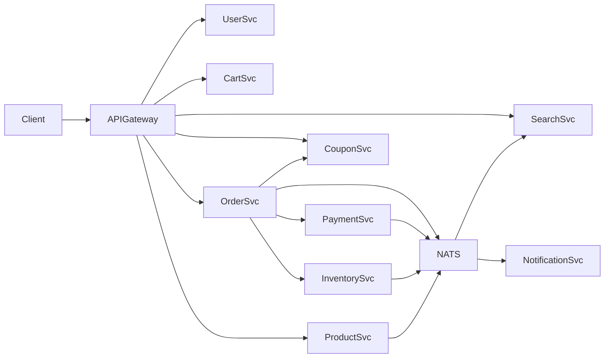
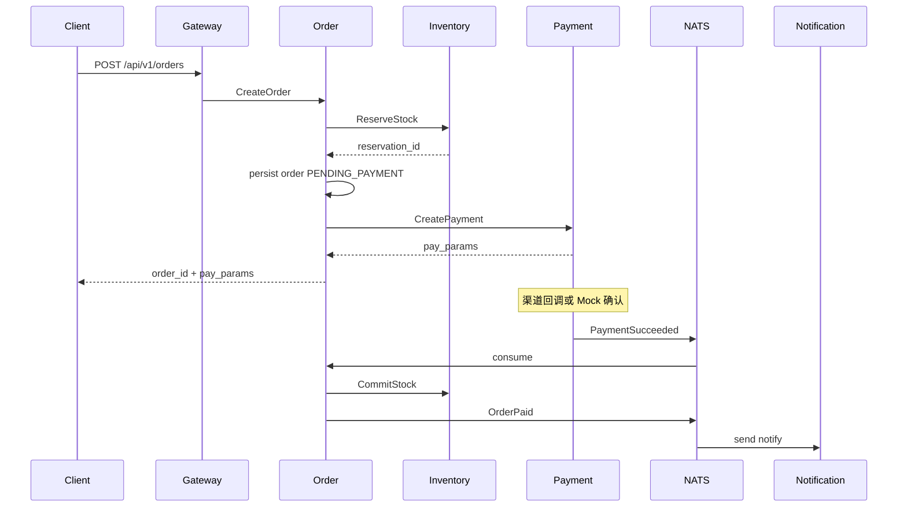

# 02 架构

## 1. 总体架构

客户端只访问 **API Gateway**。网关负责 TLS 终结（生产）、鉴权、限流、路由到后端。后端服务通过 **gRPC** 同步协作；跨服务最终一致性通过 **NATS JetStream** 领域事件完成。

## 2. 逻辑分层

| 层 | 组件 | 说明 |
|----|------|------|
| 接入层 | gateway | HTTP/JSON，JWT 校验，请求转发 |
| 应用服务层 | 各 `*-svc` | 领域逻辑、事务边界 |
| 数据层 | MySQL（每服务库）、Redis | 服务私有库，禁止跨库 join |
| 消息层 | NATS JetStream | 至少一次投递；消费者幂等 |
| 搜索层 | OpenSearch 2.x | 由 search-svc 维护索引 |
| 可观测 | OTel → Prometheus / Loki / Tempo | 指标、日志、链路；Trace 默认 Tempo |

## 3. 服务边界（一句话）

术语见 [01 总览 · 角色与术语](01-overview.md#6-角色与术语)；端口见 [14 端口矩阵](14-port-matrix.md)。

| 服务 | 职责 | 非职责 |
|------|------|--------|
| gateway | 路由、鉴权、限流、聚合轻量 BFF | 不持业务库、不做库存扣减；**不直连 inventory**（由 order 内网调用） |
| user | 账号、资料、收货地址、Token 签发 | 不管订单、支付 |
| product | SPU/SKU/类目/上下架 | 不存可售库存数量（库存在 inventory） |
| inventory | 可用量、预留、确认、释放 | 不创订单、不调支付 |
| cart | 用户购物车行项目 | 不锁库存、不清空后写订单（由 order 编排） |
| order | 订单生命周期、下单编排 | 不直连第三方支付渠道 |
| payment | 支付单、渠道适配、回调、退款抽象 | 不改订单明细（发事件驱动 order） |
| coupon | 券模板、领取、锁定/核销 | 不算运费、不创订单 |
| search | 索引与检索 API | 不作为商品主数据源 |
| notification | 按事件发送通知 | 不承载业务状态机 |

## 4. 同步 vs 异步

### 同步（请求路径内必须完成）

- 登录、商品详情、购物车读写、搜索查询
- 下单：校验商品/券 → **预留库存** → 写订单 →（可选）创建支付单并返回支付参数
- 查询订单/支付状态

### 异步（事件驱动）

- 支付成功 → 订单推进、库存确认、券核销确认、通知
- 订单取消/超时 → 库存释放、券解锁
- 商品变更 → 搜索索引更新
- 支付失败/关单 → 通知（可选）

## 5. 关键流程：下单到支付成功

## 6. 数据所有权

- 每个服务拥有独立 schema / database（Compose 中可用同一 MySQL 实例、不同 database）
- 跨服务只通过 API 或事件共享数据；需要展示的外源字段做**快照**写入本服务（如订单行的商品名、单价）
- Redis key 前缀：`{service}:{entity}:{id}`，禁止跨服务共用业务 key

## 7. 失败与补偿原则

| 场景 | 策略 |
|------|------|
| 预留成功、写订单失败 | 同步释放或短 TTL 自动过期释放 |
| 订单已建、创建支付单失败 | 订单可重试发起支付；超时关单释放库存 |
| 支付成功事件重复 | 订单/库存侧幂等（按 payment_id / reservation_id） |
| 消费者处理失败 | JetStream 重试 + DLQ（死信科目） |

## 8. 相关文档

- 服务规格：[06-services/](06-services/)
- 技术栈：[03-tech-stack.md](03-tech-stack.md)
- 事件：[09-async-events.md](09-async-events.md)
- 部署：[10-deployment.md](10-deployment.md)
- 端口矩阵：[14-port-matrix.md](14-port-matrix.md)

---

导航：[上一篇 01 总览](01-overview.md) | [下一篇 03 技术栈](03-tech-stack.md) | [返回索引](README.md)
