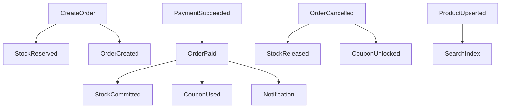

# 09 异步事件

## 1. 原则

- 投递语义：**至少一次**（At-Least-Once）
- 消费者必须**幂等**（以 `event_id` 或业务唯一键去重）
- 发布优先 **Transactional Outbox**（与业务库同事务），再由 relay 推到 NATS
- 事件为过去式事实，不可变；补偿发新事件，不改旧事件

## 2. Subject / Topic 命名

```text
minimall.<domain>.<event_name>
```

示例：`minimall.order.order_created`、`minimall.payment.payment_succeeded`

JetStream Stream 建议：

| Stream | Subjects | 保留 |
|--------|----------|------|
| `ORDERS` | `minimall.order.>` | 7–30 天 |
| `PAYMENTS` | `minimall.payment.>` | 7–30 天 |
| `INVENTORY` | `minimall.inventory.>` | 7 天 |
| `CATALOG` | `minimall.product.>` | 7 天 |
| `COUPONS` | `minimall.coupon.>` | 7 天 |

消费者组（Durable）：`search-indexer`、`order-payment-handler`、`notify-worker` 等。

## 3. 事件信封

所有事件共用信封：

```json
{
  "event_id": "01JABC...",
  "event_type": "payment.payment_succeeded",
  "occurred_at": "2026-10-13T09:00:00.000Z",
  "producer": "payment-svc",
  "trace_id": "...",
  "data": {}
}
```

## 4. 事件目录

### 4.1 order

#### `OrderCreated`

- Subject: `minimall.order.order_created`
- 触发：订单落库成功
- data：`order_id`, `order_no`, `user_id`, `pay_amount_cent`, `items[]`, `reservation_id`

#### `OrderPaid`

- Subject: `minimall.order.order_paid`
- 触发：订单状态变为 PAID
- data：`order_id`, `user_id`, `payment_id`, `paid_at`

#### `OrderCancelled` / `OrderClosed`

- data：`order_id`, `user_id`, `reason`, `reservation_id`, `coupon_id?`

### 4.2 payment

#### `PaymentSucceeded`

- Subject: `minimall.payment.payment_succeeded`
- 触发：渠道回调验签成功或 Mock 确认
- data：`payment_id`, `payment_no`, `order_id`, `user_id`, `amount_cent`, `provider`, `provider_trade_no`, `paid_at`
- 消费者：order（推进支付成功）、notification

#### `PaymentFailed` / `PaymentClosed`

- 可选；order 可保持待支付直至超时关单

### 4.3 inventory

#### `StockReserved`

- data：`reservation_id`, `order_id`, `items[]`, `expires_at`

#### `StockCommitted`

- data：`reservation_id`, `order_id`

#### `StockReleased`

- data：`reservation_id`, `order_id`, `reason`

### 4.4 product

#### `ProductUpserted` / `ProductTakenDown`

- data：`product_id`, `sku_ids[]`, `title`, `status`, `price` 摘要等
- 消费者：search 重建/更新文档

### 4.5 coupon

#### `CouponLocked` / `CouponUsed` / `CouponUnlocked`

- data：`user_coupon_id`, `user_id`, `order_id`, `template_id`

## 5. 关键链路映射



## 6. 幂等与重试

| 机制 | 说明 |
|------|------|
| 去重表 | `processed_events(event_id PK, consumer, processed_at)` |
| 业务幂等 | 如 order 仅当 `PENDING_PAYMENT` 才转 `PAID` |
| 重试 | JetStream ack 超时重投；指数退避 |
| DLQ | 超过 N 次进入 `minimall.dlq.>`，告警人工处理 |

## 7. 超时关单

- 独立调度（order-svc 定时扫 `expires_at` 或延迟消息）
- 关单事务：状态 CLOSED + outbox `OrderClosed` → inventory Release + coupon Unlock

## 8. 相关文档

- 架构：[02-architecture.md](02-architecture.md)
- 订单服务：[06-services/order.md](06-services/order.md)
- 支付服务：[06-services/payment.md](06-services/payment.md)

---

导航：[上一篇 08 数据模型](08-data-models.md) | [下一篇 10 部署](10-deployment.md) | [返回索引](README.md)
