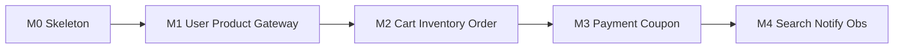

# 13 路线图与验收

## 1. 阶段总览

## 2. M0 — 仓库与中间件

**交付**

- Monorepo 骨架（`cmd`/`internal`/`api`/`deployments`）
- Compose：`mysql` / `redis` / `nats` 健康
- 公共 `pkg`：config、errx、日志骨架
- 文档：`docs/`（本套）

**验收**

- [ ] `docker compose --profile infra up -d` 后中间件 healthy
- [ ] 可创建各业务 database
- [ ] `go build` 空服务可编译（代码阶段）

## 3. M1 — 用户、商品、网关

**交付**

- 注册/登录/刷新、地址 CRUD
- 类目与 SPU/SKU CRUD、上架查询
- Gateway 鉴权与路由

**验收**

- [ ] 注册登录拿到 JWT，访问 `/users/me`
- [ ] 创建商品并 `GET /products/{id}`
- [ ] 无 Token 访问受保护接口返回 401

## 4. M2 — 购物车、库存、订单

**交付**

- 购物车增删改查
- 库存初始化、预留/释放
- 下单编排、取消、超时关单

**验收**

- [ ] 下单成功返回 `PENDING_PAYMENT` 与 `reservation_id` 关联
- [ ] 库存 `available` 减少、`reserved` 增加
- [ ] 取消订单后库存恢复
- [ ] 重复 `Idempotency-Key` 不产生第二单

## 5. M3 — 支付、优惠券

**交付**

- Mock 支付确认与回调框架
- 领券、下单锁券、支付成功核销
- `PaymentSucceeded` → 订单 PAID → `CommitStock`

**验收**

- [ ] Mock 确认后订单为 PAID，库存 reserved 扣减完成
- [ ] 用券订单金额正确；取消后券回到未用
- [ ] 支付回调重放不重复推进

## 6. M4 — 搜索、通知、可观测

**交付**

- 商品事件驱动索引与搜索 API
- 通知消费并写 log/站内信
- Prometheus + Grafana 基础看板；关键路径 Trace

**验收**

- [ ] 商品变更后搜索结果最终一致（秒级可接受）
- [ ] 支付成功产生通知记录
- [ ] Grafana 可见下单/支付指标；某一单可按 `trace_id` 串联

## 7. 建议实现顺序（服务）

1. user → product → gateway  
2. inventory → cart → order  
3. payment → coupon  
4. search → notification  
5. 加固：outbox relay、关单任务、限流、告警

## 8. 明确延期（Backlog）

- 真实微信/支付宝适配、退款与售后
- 多仓/拆单/运费模板
- 秒杀专用库存通道
- Kubernetes / Istio
- 完整商家后台与 RBAC

## 9. 文档维护

- 接口或表结构变更时同步 `06-services/*`、`08`、`09`
- 端口/依赖变更同步 [14-port-matrix.md](14-port-matrix.md)
- 错误码变更同步 [15-error-codes.md](15-error-codes.md) 与对应服务文
- 技术栈以 [03-tech-stack.md](03-tech-stack.md) **一期正式选型**为准

## 10. 下一步

从 **M0 代码骨架 + Compose 文件落地** 开始，按本文验收清单推进。

---

导航：[上一篇 12 安全](12-security.md) | [下一篇 14 端口矩阵](14-port-matrix.md) | [返回索引](README.md)
